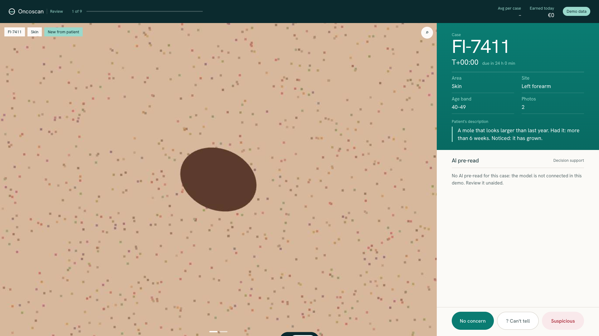

# Oncoscan

A browser prototype of photo-first cancer triage: a patient sends photos of a worrying skin or mouth spot, a specialist reviews them, and the patient gets a result with a next step. Built at Junction 2026 for AstraZeneca's "Equal Care Across Finland" challenge.



## Run it

```bash
node server.mjs
```

Then open:
- http://localhost:4173/landing/ (landing page)
- http://localhost:4173/patient/ (patient flow)
- http://localhost:4173/review/ (specialist queue)

### AI photo analysis (optional)
Copy `.env.example` to `.env` and paste a Google Gemini API key into it, then restart the server. The specialist's "Signal check" then analyses the photo with Gemini (`gemini-3.5-flash-lite` by default). **The photo, area and body site are sent to Google**; the patient's description is not. Gemini only describes the photo: its score is not used, because on our 42 labelled test images it could not tell cancer from benign lesions (`node tools/eval.mjs`; results in `review/cases/ham10000/gemini-eval-*.json`). Without a key, demo cases show a hand-written example and patient cases are checked from the patient's answers only.

Open the patient and specialist pages in two tabs of the **same browser**. A case sent from the patient tab appears first in the specialist queue; the signed verdict returns to the patient tab.

## Test it

```bash
cd tools && npm i puppeteer-core && node journey.mjs ./out 5
```

Runs the full journey 5 times in headless Chrome and writes screenshots, recordings and `run-report.json`. Needs Google Chrome and ffmpeg.

## What is real and what is simulated

| Real (runs in the browser) | Simulated or not built |
|---|---|
| 5-step patient submission with validation | Sign-in: any email works, nothing is sent |
| Photo downscaling and a darkness/blur check | Email delivery: shown as a preview |
| Case clock and status | County cover list and the €29 price: examples |
| Specialist queue, swipe or keyboard verdicts, notes, undo | Payment: no charge is made |
| Verdict returning to the patient as one of three results | AI photo analysis: only with a Gemini key (see above). Otherwise scores on demo cases are hand-written |
| | Licence check, calibration, payouts, second review |
| | The 24-hour turnaround: a clock, not a service |
| | Landing-page "Case flow" panel: a labelled simulation |

## Limitations
- No backend. Data lives in `localStorage`, so both roles must use one browser on one computer.
- The 8 demo cases are fictional and have no photos (a placeholder is shown).
- Not tested with users, on real clinical images, or on a physical phone.
- Not a medical device. Nothing here gives a diagnosis.

## Built during the hackathon vs pre-existing
- **Built during Junction 2026:** everything in this folder.
- **Pre-existing:** the concept draws on the team's earlier product, Oriscan. No Oriscan code, data or models are in this repository.
- **External:** Hanken Grotesk and Newsreader (Google Fonts), Solar icons via Iconify, GSAP and ScrollTrigger from a CDN. Photos on the landing page were supplied by the team.
