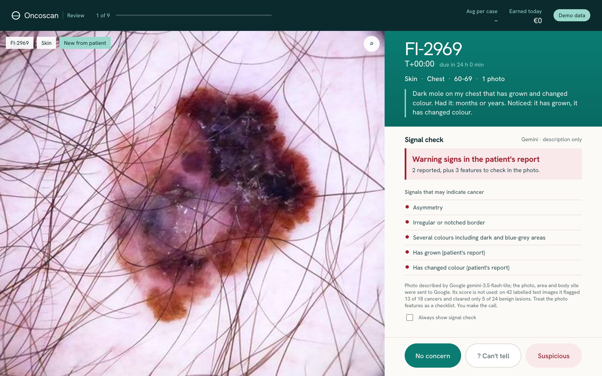
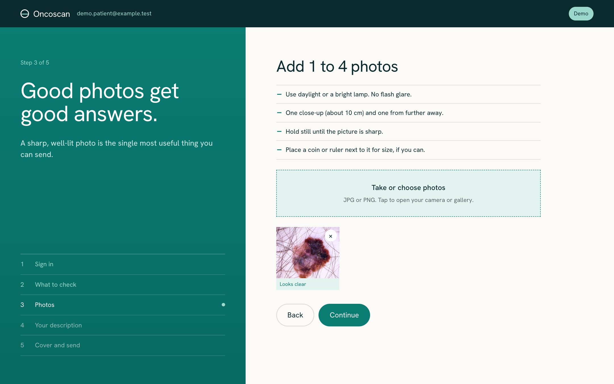
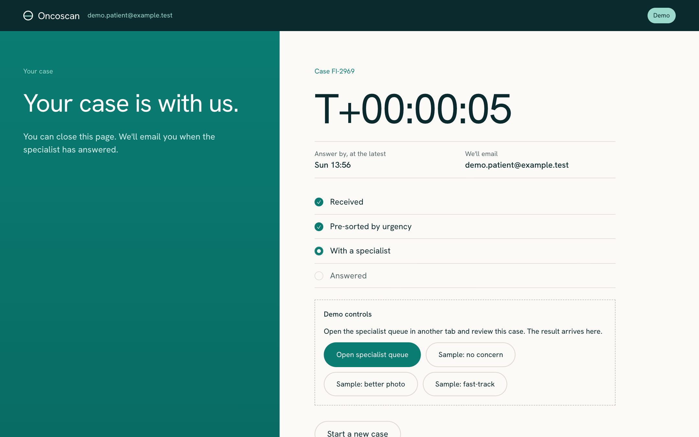
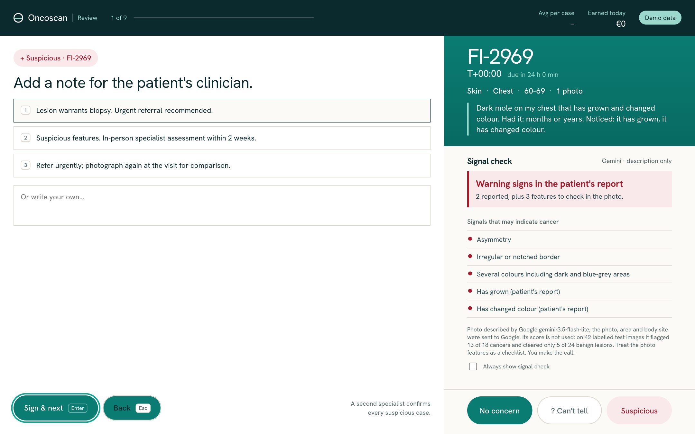
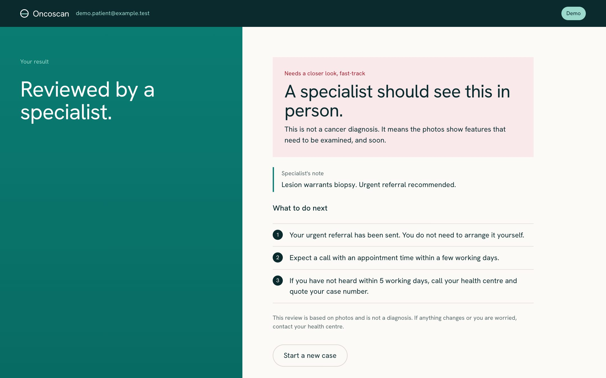
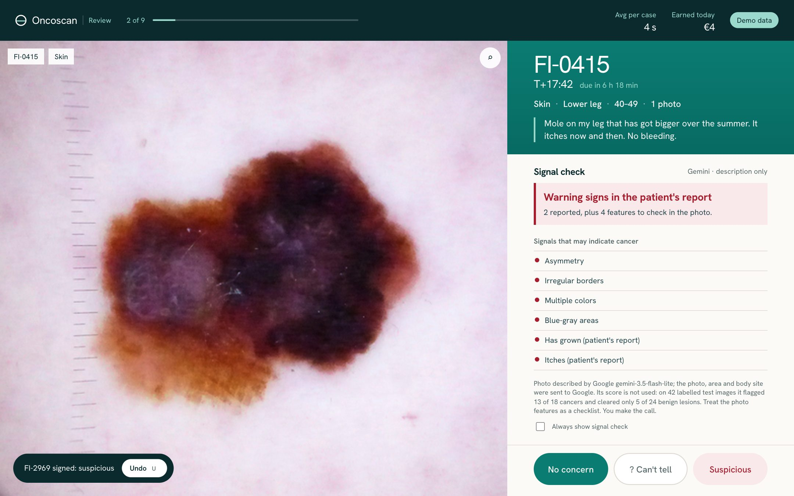
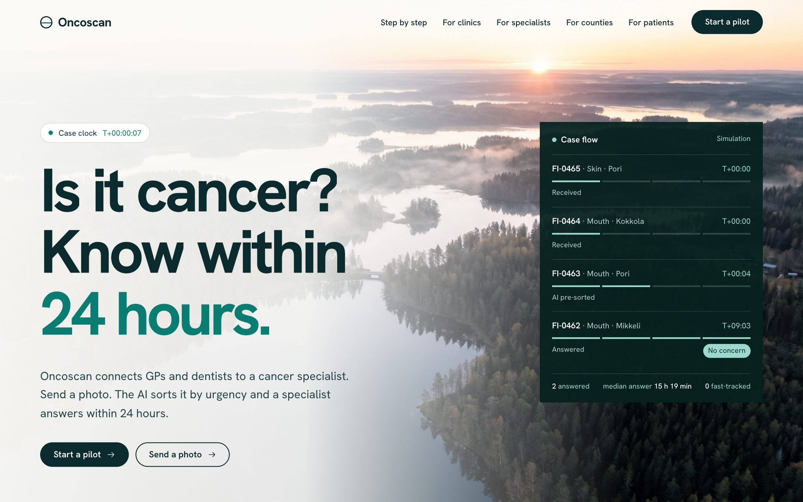
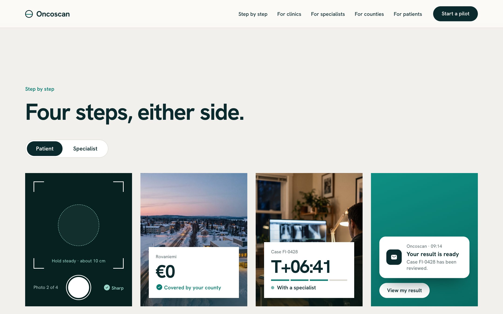

# Oncoscan

A working prototype of photo-first cancer triage. A patient sends photos of a worrying skin or mouth spot, a specialist reviews them, and the patient gets a result with a next step. Built at Junction 2026 for AstraZeneca's "Equal Care Across Finland" challenge.



Every screenshot on this page is a capture of the running product. The lesion images are real dermoscopy photos from the public HAM10000 dataset; nothing is mocked up or drawn.

## The journey

| 1 · The patient adds a photo | 2 · The case clock starts |
|---|---|
|  |  |
| Each photo is checked for darkness and blur before it is sent. | The case goes to the front of the specialist's queue. |

| 3 · The specialist reviews and signs | 4 · The patient gets a next step |
|---|---|
|  |  |
| One key for the verdict, one for the note. | Three possible results. It never says "you have cancer". |

### The signal check



For each case the specialist sees a plain verdict and two lists: signals that may indicate cancer, and signs against it. Items marked "(patient's report)" come from the patient's answers. After signing a demo case, the dataset's confirmed diagnosis is shown.

### The landing page




## Run it

```bash
node server.mjs
```

Then open:
- http://localhost:4173/landing/ (landing page)
- http://localhost:4173/patient/ (patient flow)
- http://localhost:4173/review/ (specialist queue)

Open the patient and specialist pages in two tabs of the **same browser**. A case sent from the patient tab appears first in the specialist queue; the signed verdict returns to the patient tab. Needs Node 18 or newer and no packages.

### AI photo description (optional)

```bash
sh tools/set-key.sh
```

This asks for a Google Gemini API key and saves it to `.env`. Restart the server afterwards. The specialist's signal check then asks Gemini (`gemini-3.5-flash-lite` by default) to describe each photo. **The photo, area and body site are sent to Google**; the patient's description is not.

## What we measured

| Test | Result |
|---|---|
| Full journey, automated in headless Chrome (`tools/journey.mjs`) | 5 of 5 runs passed, twice |
| Photo check on a sharp, a dark and a blurred test image | 3 of 3 labelled correctly |
| Gemini's score on 42 labelled HAM10000 images, photo only (`tools/eval.mjs`) | **Not usable for triage** (below) |

| Gemini model | Cancers flagged (of 18) | Benign cleared (of 24) |
|---|---|---|
| `gemini-3.5-flash-lite` | 13 | 5 |
| `gemini-3.8-flash` | 11 | 11 |

A general vision model could not tell cancer from benign lesions on the photo alone. So Gemini only **describes** the photo here. Its score is hidden, and the verdict comes from the patient's report and a sharpness check. Per-image results are in `review/cases/ham10000/gemini-eval-*.json`.

## What is real and what is simulated

| Real | Simulated or not built |
|---|---|
| 5-step patient submission with validation | Sign-in: any email works, nothing is sent |
| Photo downscaling and a darkness and blur check | Email delivery: shown as a preview |
| Case clock and status | County cover list and the €29 price: examples |
| Specialist queue, swipe or keyboard verdicts, notes, undo | Payment: no charge is made |
| Verdict returning to the patient as one of three results | A model that can triage from the photo |
| Photo description by Gemini, when a key is set | Licence check, calibration, payouts, second review |
| 5 skin demo cases with real images and confirmed labels | The 3 mouth demo cases: fictional, no image |
| | The 24-hour turnaround: a clock, not a service |
| | Landing-page "Case flow" panel: a labelled simulation |

## Limitations
- Data lives in the browser's `localStorage`, so both roles must use one browser on one computer.
- For the 5 skin demo cases the image, body area, age band and diagnosis come from the dataset. The patient's words and the hand-written example analysis are ours.
- Without a Gemini key, the demo cases show that hand-written example analysis.
- The sharpness check is crude: it also flags some smooth, low-contrast lesions.
- Not tested with clinicians or patients, on phone-camera photos of lesions, or on a physical phone.
- Not a medical device. Nothing here gives a diagnosis.

## Images and data
The skin images are a 42-image sample of **HAM10000** (Tschandl, Rosendahl and Kittler, Scientific Data 5, 180161, 2018), downloaded from Kaggle. See `review/cases/ham10000/SOURCE.md` for the source and licence notes: as far as we know the dataset is CC BY-NC 4.0, non-commercial use with attribution. Landing-page photos were supplied by the team.

## Built during the hackathon vs pre-existing
- **Built during Junction 2026:** everything in this repository.
- **Pre-existing:** the concept draws on the team's earlier product, Oriscan. No Oriscan code, data or models are here.
- **External:** Hanken Grotesk and Newsreader (Google Fonts), Solar icons via Iconify, GSAP and ScrollTrigger from a CDN, and the Google Gemini API when a key is set.

## Repository layout
| Path | What it is |
|---|---|
| `landing/`, `patient/`, `review/` | The three screens |
| `server.mjs` | Static server plus the Gemini call |
| `tools/` | `journey.mjs` (end-to-end test), `eval.mjs` (model test), `set-key.sh` |
| `presentation/` | Submission text, deck, video and the evidence ledger |
| `docs/screenshots/` | The images on this page |
